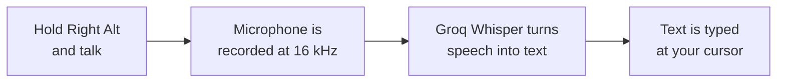

<div align="center">

# hearing_bot

**Hold a key, speak, let go. Your words are typed wherever your cursor is.**

Push-to-talk voice typing and AI writing tools for Windows, powered by Groq Whisper.

[](#quick-start)
[](https://www.python.org/downloads/)
[](https://groq.com)
[](LICENSE)

[Features](#features) · [Quick start](#quick-start) · [Shortcuts](#shortcuts) · [How it works](#how-it-works) · [Configuration](#configuration) · [FAQ](#faq)

</div>

Windows voice typing (<kbd>Win</kbd> + <kbd>H</kbd>) keeps listening until you tell it to stop. hearing_bot works like a walkie-talkie instead: it listens only while you hold <kbd>Right Alt</kbd> and types the text as soon as you let go. The same key also gives you AI tools for the text you're working on, and the whole thing runs quietly in the background.

## Features

- **Dictation in almost any app**, including browsers, VS Code, Word, Slack and WhatsApp.
- **Speak any language, get English.** Talk in Hindi or any other language and the English translation is typed.
- **Fix, rewrite and explain.** Correct the grammar of a selection, rewrite it by saying how ("make it formal"), or get a plain-English explanation of an error or a piece of code.
- **Voice notes.** Save a thought without leaving what you're doing. It goes into a Markdown file with the date and time.
- **AI commit messages.** `git aic` writes the commit message from your staged changes.
- **Lightweight.** About 30 MB of RAM and two Python dependencies. It starts with Windows and stays out of sight.
- **One-step setup.** Double-click `install.cmd`. No admin rights needed.

## Quick start

**You need** Windows 10 or 11, [Python 3.10 or newer](https://www.python.org/downloads/), a microphone, and a free Groq API key from [console.groq.com/keys](https://console.groq.com/keys).

1. Get the code:

   ```powershell
   git clone https://github.com/Priyanshukv06/hearing_bot.git
   cd hearing_bot
   ```

   Or [download the ZIP](https://github.com/Priyanshukv06/hearing_bot/archive/refs/heads/main.zip) and unzip it.

2. Run the installer and paste your API key when it asks. You can also double-click `install.cmd` in File Explorer.

   ```powershell
   .\install.cmd
   ```

3. Click in any text box, hold <kbd>Right Alt</kbd>, say something, and let go.

The installer creates a Python virtual environment, checks your key with Groq, saves it as the `GROQ_API_KEY` environment variable, adds the bot to startup, sets up `git aic`, and starts the bot. From then on, it starts by itself every time you sign in.

## Shortcuts

| Shortcut | What it does |
|---|---|
| Hold <kbd>Right Alt</kbd> | **Dictate.** Types what you say. |
| <kbd>Right Alt</kbd> + <kbd>T</kbd>, keep holding | **Translate.** Types the English translation of what you say. |
| <kbd>Right Alt</kbd> + <kbd>N</kbd>, keep holding | **Voice note.** Adds what you say to `Documents\voice_notes.md` with the date and time. |
| <kbd>Right Alt</kbd> + <kbd>R</kbd>, keep holding | **Rewrite.** Rewrites the selected text the way you say, for example "make it formal". |
| <kbd>Right Alt</kbd> + <kbd>F</kbd> | **Fix.** Corrects the spelling and grammar of the selected text. |
| <kbd>Right Alt</kbd> + <kbd>E</kbd> | **Explain.** Explains the selected text (an error, some code, anything) in a popup. |

> [!TIP]
> For the voice shortcuts, press <kbd>Right Alt</kbd>, tap the letter, then keep holding <kbd>Right Alt</kbd> while you talk. The text appears about a second after you let go.

While it records, the Windows microphone icon appears in the taskbar.

### AI commit messages

Stage your changes in any git repository and run `git aic`. You can commit with the suggested message, edit it first, or cancel.

```text
> git add .
> git aic

Add retry when an idle Groq connection is dropped

Commit with this message? [Y]es / [e]dit / [n]o:
```

## How it works



For Fix, Rewrite and Explain, the selected text is copied with <kbd>Ctrl</kbd> + <kbd>C</kbd> and sent to Groq's `openai/gpt-oss-120b` model. Fixed and rewritten text is pasted over the selection, and the text you had on the clipboard is put back afterwards.

Under the hood:

- A low-level Windows keyboard hook, written with plain `ctypes`, watches <kbd>Right Alt</kbd> and hides it from other apps, so it never opens menus.
- The microphone is recorded with `sounddevice` only while the key is held, and is off the rest of the time.
- Dictated text is typed as Unicode key presses with `SendInput`, so the clipboard isn't touched.
- Recording and processing run on separate threads, so you can start the next recording while the last one is still being processed.

## Configuration

The settings are at the top of two files. After changing one, run `install.cmd` again to restart the bot.

| Setting | File | Default | What it controls |
|---|---|---|---|
| `HOTKEY_VK` | `hearing_bot.py` | `0xA5` (Right Alt) | The key you hold. `0xA3` is Right Ctrl and `0x14` is Caps Lock. |
| `ACTION_KEYS` | `hearing_bot.py` | T, N, R, F, E | The letter for each shortcut. |
| `LANGUAGE` | `hearing_bot.py` | `"en"` | The language you dictate in. `None` detects it automatically. |
| `NOTES_FILE` | `hearing_bot.py` | `None` (your Documents folder) | Where voice notes are saved. |
| `SPEECH_MODEL` | `groq_api.py` | `whisper-large-v3-turbo` | The speech-to-text model. |
| `CHAT_MODEL` | `groq_api.py` | `openai/gpt-oss-120b` | The model for Fix, Rewrite, Explain and `git aic`. |

## FAQ

<details>
<summary><b>Nothing gets typed. What should I check?</b></summary>

Make sure Settings > Privacy & security > Microphone > "Let desktop apps access your microphone" is on. Then open `hearing_bot.log` in the project folder, where every error is written. hearing_bot also can't type into apps running as administrator, because Windows blocks input from normal apps into them.

</details>

<details>
<summary><b>What do the sounds mean?</b></summary>

An error sound means a request failed, usually because there was no internet connection, the API key was rejected, or the free-plan limit was reached. The reason is in `hearing_bot.log`. A warning sound after Fix, Rewrite or Explain means no text was selected. A short ding confirms a voice note was saved.

</details>

<details>
<summary><b>My keyboard has an AltGr key.</b></summary>

On layouts where Right Alt is AltGr (for example German, French, Polish or India), you can't type AltGr characters with Right Alt while the bot runs. <kbd>Ctrl</kbd> + <kbd>Left Alt</kbd> + the key still types them, or you can set `HOTKEY_VK` to a different key.

</details>

<details>
<summary><b>Is it safe to use in a terminal?</b></summary>

Dictation is. Fix, Rewrite and Explain copy your selection with <kbd>Ctrl</kbd> + <kbd>C</kbd>, and in a terminal that stops the running command if nothing is selected. Select the text first.

</details>

<details>
<summary><b>How much does it cost?</b></summary>

Nothing for normal use. Groq's free plan allows about 2,000 speech requests a day. See [Groq's rate limits](https://console.groq.com/docs/rate-limits) for details.

</details>

<details>
<summary><b>Where does my data go?</b></summary>

Your recordings and the text you select are sent to Groq to be processed. Nothing else leaves your PC. The log stores only timings and errors, never what you said or selected.

</details>

<details>
<summary><b>How do I stop or restart it?</b></summary>

Run `install.cmd` again to restart it. To stop it until you next sign in, end `pythonw.exe` on the Details tab of Task Manager. To remove it completely, see [Uninstall](#uninstall).

</details>

## Project structure

```text
hearing_bot/
├── hearing_bot.py     Background app: hotkey, recording, typing and AI actions
├── groq_api.py        Groq calls: speech to text, translation and chat
├── ai_commit.py       The git aic command
├── install.ps1        Installer and uninstaller
├── install.cmd        Double-click to install
├── uninstall.cmd      Double-click to uninstall
└── requirements.txt   Python dependencies (requests, sounddevice)
```

## Uninstall

Double-click `uninstall.cmd`. It stops the bot, removes it from startup and removes `git aic`. Then delete the folder. Your API key stays saved, and the uninstaller shows the command that removes it too.

## Contributing

Bug reports and pull requests are welcome. For bigger changes, please open an issue first so we can discuss the idea.

## License

Released under the [MIT License](LICENSE).
